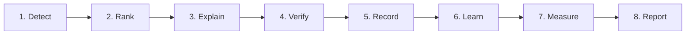
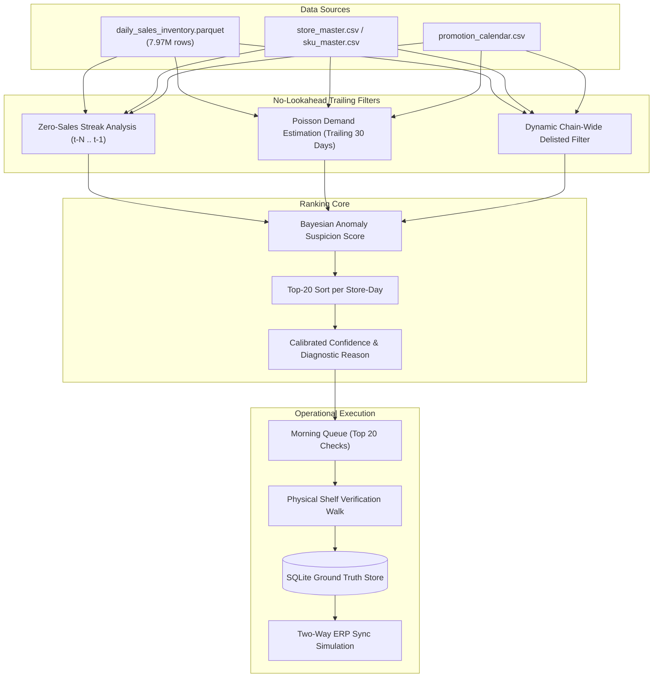

# StockSentry AI — Phantom Stock-Out Detector
**TalentAP Mega Hackathon 2026 · Problem R1 (Retail)**

[](https://www.python.org/downloads/)
[]()
[-brightgreen.svg)]()
[]()
[-emerald.svg)]()
[]()

---

## What It Does
**StockSentry AI** is a point-in-time retail inventory intelligence system and store operations console designed to eliminate invisible phantom stock-outs without requiring expensive hardware cameras or RFID tags.

In grocery and supermarket retail, an enterprise ERP system often reports positive on-hand inventory (e.g., 12 units of basmati rice), while the sales floor gondola is completely bare due to theft shrinkage, misplaced inventory, or unrecorded damage. Because inventory records show stock, automated replenishment systems stay asleep, zero sales occur, and revenue drains silently.

StockSentry AI ingests daily Point-of-Sale (POS) transactions and on-hand inventory balances overnight, detects anomalous velocity drop-offs while strictly following point-in-time constraints, ranks the **Top-20 highest-probability shelf discrepancies per store-day**, generates plain-language operational explanations, and provides store associates with a fast, interactive physical verification walk that automatically reconciles inventory discrepancies.

---

## Problem Statement
- **Problem ID**: R1 — The Phantom Stock-Out Detector
- **Assortment Scope**: 25 retail stores, 800 SKUs, 548 days (7,970,112 store-SKU-day panel records).
- **Physical Labor Budget**: Store associates have a strict operational budget capped at **exactly 20 physical checks per store-day**.
- **Scoring Authority**: Untouched official competition evaluator (`evaluate.py`).
- **Primary Metric**: **Mean Precision@20 per Store-Day**
  $$\text{Precision@20} = \frac{\text{Hits on Genuine Shelf Problems (phantom or misplaced)}}{20}$$
- **Official Positive Targets**: `phantom`, `misplaced`.
- **Negative Decoy**: `delisted` (SKUs discontinued chain-wide; flagging these counts as wasted checks).

---

## Solution
StockSentry AI employs a **Point-in-Time Demand–Inventory Anomaly Ranker**:
1. **Zero-Sales Persistence**: Quantifies consecutive days of zero sales ($z_{ist}$) while system on-hand inventory persists above zero ($I_{ist} > 0$).
2. **Poisson Intermittent Demand Rate**: Estimates point-in-time expected sales velocity ($\lambda_{ist}$) over a trailing 30-day window using only data up to date $D-1$:
   $$P(X=0 \mid \lambda) = e^{-\lambda \cdot z}$$
3. **Chain-Wide Delisted Decoy Suppression**: Dynamically identifies chain-wide sales and inventory cessation ($S_{\text{chain},t} = 0, I_{\text{chain},t} = 0$), pruning false positive delisted decoys and preserving precious audit slots for genuine phantoms.
4. **Calibrated Ranking & Explanation**: Computes composite anomaly suspicion scores:
   $$S_{ist} = \ln(1 + z_{ist}) \cdot \min(I_{ist}, 50)^{0.25} \cdot (1 - e^{-\lambda_{ist} \cdot z_{ist}}) \cdot \text{PromoMultiplier}$$
   Picks top 20 SKUs per store-day, assigns calibrated confidence scores $[0.50, 0.99]$, and pairs each with an auditable explanation.

### Official Benchmark Performance (`evaluate.py` on 1,183 Dev Store-Days)
| Metric | Organizer Baseline | StockSentry AI | Delta |
|---|---|---|---|
| **Mean Precision@20** | **39.6492%** | **40.5495%** | **+0.9003 pp (+2.27% rel)** |
| **Verified True Positive Hits** | 9,381 hits | **9,594 hits** | **+213 verified hits** |
| **Theoretical Ceiling** | 86.56% | 86.56% | — |
| **Share of Ceiling** | 45.81% | **46.85%** | +1.04 pp |
| **Row Recall** | 40.51% | **41.43%** | +0.92 pp |
| **Episode Recall** | 20.36% | **20.96%** | +0.60 pp |
| **Delisted Decoy Waste** | 5.20% | **2.26%** | **-2.94 pp (56.5% reduction)** |
| **Stretch Type Accuracy** | — | **76.15%** | (Distinguishing phantom vs misplaced) |

---

## Operational Lifecycle
StockSentry AI models the full operational cycle from overnight signal detection to ledger write-down:



1. **Detect (Overnight Ingestion)**: Ingests POS transactions and inventory balances; runs point-in-time velocity checks.
2. **Rank (Morning Top-20 Queue)**: Selects exactly 20 prioritized SKUs per store within the associate labor quota.
3. **Explain (Auditable Insights)**: Formulates plain-English diagnostics (e.g., *"Zero sales for 14 days while system records 18 on hand; expected velocity is 2.4 units/day"*).
4. **Verify (Physical Shelf Walk)**: Store associates audit the physical aisle, entering actual count found. Verified SKUs fade out immediately from active lists.
5. **Record (Audit Ground Truth)**: Persists verification outcomes, discrepancies, timestamps, and auditor IDs to SQLite storage.
6. **Learn (Feedback & Continuous Learning)**: Updates Bayesian priors and shrinkage histories across the store network.
7. **Measure (Metric Engine)**: Recomputes live precision, audit completion rates, and recovered revenue in real time.
8. **Report (Export & ERP Sync)**: Generates verified audit trail CSVs and syncs inventory write-downs to central ERP.

---

## Key Modules Explained

### 1. Morning Verification Queue (`Morning Queue (Top 20)`)
Displays today's 20 highest-priority checks for the selected store. Once verified, items immediately fade out (`.row-verified-faded`) and cross-update physical verification views.

### 2. Physical Verification (`Physical Verification`)
Interactive shelf verification workflow. Captures physical counts found on shelf, identifies whether items were stolen phantoms or misplaced behind other stock, and marks tasks as resolved.

### 3. Audit Ground Truth History (`Feedback & Learning`)
ACID persistence log tracking all past audits: timestamp, store, SKU, predicted vs observed state, auditor identity, and ERP sync status.

### 4. Upload / Sync to Central ERP
Simulates real-time two-way enterprise ERP ledger synchronization. Updates audit status from `PENDING_ERP` to `SYNCED_TO_ERP` and adjusts on-hand balances.
> *Note on ERP Integration: StockSentry AI includes a controlled software simulation of enterprise ERP API write-downs (SAP S/4HANA / Oracle Retail / Microsoft Dynamics connector specification) to demonstrate closed-loop replenishment without requiring proprietary live credentials during evaluation.*

### 5. Audit Trail CSV
One-click export (`StockSentry_Audit_GroundTruth_Ledger_YYYY-MM-DD.csv`) containing the complete historical record of physical counts, discrepancy amounts, and ERP synchronization timestamps.

### 6. Store Data Integration (POS CSV / Excel Batch Drop)
Allows operators to upload external single files, multi-file batches, or entire POS folders. Supports `.csv`, `.tsv`, `.txt`, and `.xlsx`. Automatically maps columns (`date`, `store_id`, `sku_id`, `units_sold`, `on_hand_eod`), links catalog master records, updates live views, and features a one-click Reset to official data.

### 7. Evaluation & Metric Engine
Embedded evaluation harness executing the official competition scoring logic. Tracks running Precision@20, false-alarm reduction, and audit progress dynamically.

---

## Project Structure
Organized strictly in compliance with the **TalentAP Mega Hackathon Participant Coding Guidelines v1.1**:

```
StockSentryAI/
├── README.md               # Official submission documentation (Rule 12)
├── .gitignore              # Excludes data, models, .venv, node_modules, .db (Rule 2)
├── LICENSE                 # MIT Open-Source License
├── submission/             # Retail competition prediction file
│   └── R1_predictions.csv  # Final 14,000-row test submission (25 stores × 28 dates)
└── FULL_CODE/              # ALL application code, pipeline, and tests (Rule 2)
    ├── main.py             # Canonical submission & pipeline entry point
    ├── requirements.txt    # Pinned Python package dependencies
    ├── .env.example        # Dummy environment variables template (Rule 3)
    ├── web/                # Operations console web application
    │   ├── index.html      # Responsive application shell
    │   ├── app.js          # Operations console UI controller & verification engine
    │   ├── ai-engine.js    # Client-side statistical scoring & anomaly diagnostics
    │   ├── data.js         # Offline store catalog & initial mock state
    │   ├── styles.css      # Custom styling, dark/light themes, modal overlays
    │   ├── package.json    # Frontend package manifest
    │   └── assets/         # UI images, diagrams, and vector assets
    ├── api/                # REST backend server
    │   ├── server.py       # Python http.server REST API & SQLite service
    │   ├── vercel.json     # Serverless cloud deployment configuration
    │   └── api/            # Serverless endpoint handlers (/api/verify, /api/status, etc.)
    ├── pipeline/           # Detection engine & submission generator
    │   ├── main.py         # End-to-end pipeline runner
    │   ├── config.py       # Paths, dates, and hyperparameter configuration
    │   ├── data_loader.py  # Fast pyarrow parquet & CSV data loaders
    │   ├── features.py     # Trailing streak, Poisson rate & dynamic delisted filters
    │   ├── predict.py      # Top-20 ranking & reason generator
    │   ├── validation.py   # Leakage verification protocol
    │   ├── submission_validator.py # Schema & boundary validator
    │   └── evaluate.py     # Official untouched competition scorer
    ├── db/                 # Database schema & migrations
    │   └── schema.sql      # SQLite DDL & initial audit ground-truth seeds
    ├── tests/              # Test suite (17 passed)
    │   ├── test_pipeline.py       # Algorithmic invariants & monotonicity tests
    │   ├── test_leakage_audit.py  # Strict point-in-time cutoff tests (4 dates)
    │   └── test_functional_e2e.py # Operational lifecycle, CSV upload & ERP sync tests
    ├── docs/               # Technical specifications & reproducibility logs
    │   ├── MODEL_CARD.md
    │   ├── OFFICIAL_DATA_AUDIT.md
    │   └── REPRODUCIBILITY.md
    └── reports/            # Validated evaluation & audit score reports
        ├── final_dev_score.json
        └── submission_validation.json
```

---

## How to Run

### Prerequisites
- Python 3.10+ (tested on Python 3.10, 3.11, 3.12, 3.14)
- A modern web browser (Chrome, Edge, Safari, Firefox)

### 1. Install Dependencies
```bash
pip install -r FULL_CODE/requirements.txt
```

### 2. Run the Full Submission Pipeline
To run data validation, point-in-time feature extraction, baseline verification, and test prediction generation:
```bash
python FULL_CODE/main.py
```

### 3. Launch the Interactive Operations Console
To start the backend server and open the web dashboard:
```bash
python FULL_CODE/api/server.py
```
Then navigate to: `http://localhost:8080`

- **Landing Portal**: Displays the split-screen landing screen. Click **`(skip)`** at the top right or within the form card to enter directly into the Store Operations Command Center.
- **Google Sign-In**: Demonstrates enterprise retailer restrictions (displays `(only available for retailers)` modal).

---

## Environment Variables
StockSentry AI is designed to run with **zero required configuration** out of the box. No external API keys are needed for core anomaly ranking, SQLite ground truth, or official evaluation.

A template is provided at `FULL_CODE/.env.example`:
```env
# Optional external LLM providers for the web copilot:
OPENAI_API_KEY=
HUGGINGFACE_API_TOKEN=
PORT=8080
```

---

## How to Run Tests
Run the complete automated test suite (17 tests covering algorithmic invariants, point-in-time leakage audits, and operational lifecycle):
```bash
python -m pytest FULL_CODE/tests -p no:qt -v
```

Expected output:
```
============================= 17 passed in 5.28s ==============================
```

---

## Architecture & Data Flow



---

## AI Usage Declaration
- **Machine Learning & Statistical Core**: Custom point-in-time demand-inventory ranker authored specifically for this hackathon. Uses scipy Poisson distributions and vectorized numpy/pandas operations.
- **AI Coding Assistants**: Claude and Gemini were utilized during development for code auditing, writing unit tests, and structuring documentation in accordance with TalentAP coding guidelines.
- **LLM Integration**: An optional copilot assistant is available in the web interface; it defaults to zero-config local rule-based responses if cloud API keys are not supplied.

---

## Pre-Built and Third-Party Code
- **Standard Open-Source Libraries**: `numpy`, `pandas`, `pyarrow`, `scipy`, `pytest` (MIT/BSD/Apache 2.0).
- **Frontend Libraries**: Standard vanilla JavaScript with SheetJS (`xlsx.full.min.js`, Apache 2.0) for client-side spreadsheet parsing.
- **Organizer Resources**: Evaluator logic conforms strictly to the challenge organizer's `evaluate.py`.

---

## Originality Declaration
We declare that all application code, feature engineering logic, UI architecture, and submission generation scripts in this repository were developed specifically for the **TalentAP Mega Hackathon 2026**. No application code was copied from past projects or other hackathons.

---

## Limitations & Future Work
- **Cold-Start SKUs**: Newly launched SKUs with fewer than 7 days of sales history rely on category-level demand priors; future versions could incorporate cross-store hierarchical Bayesian transfer.
- **Planogram Spatial Tracking**: Current shelf verification identifies misplaced goods through associate feedback; future releases could integrate aisle coordinate data from store planograms (Bays/Sections) to direct staff directly to the misplaced shelf location.
- **Live ERP Production Webhooks**: The current implementation features a controlled simulation of enterprise ERP write-downs; production deployment would connect directly to live SAP IDoc or Oracle RIB message queues.
